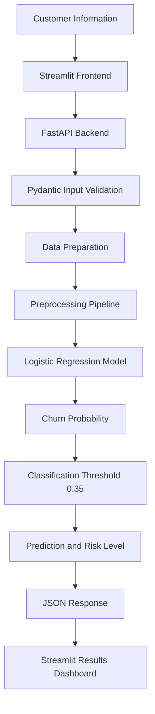

# Customer Churn Intelligence Platform

An end-to-end machine learning application that predicts customer churn probability and classifies customers based on their risk of leaving a telecom service.

The platform combines a **Logistic Regression model**, a reusable Scikit-learn preprocessing pipeline, a **FastAPI backend**, and an interactive **Streamlit frontend** to help identify customers who may be likely to churn and support data-driven customer retention strategies.

## Live Demo

- **Streamlit Application:** [Open Live Application](https://customer-churn-intelligence-platformgit-mic9xakmp6o62govnjtzav.streamlit.app/)
- **FastAPI Backend:** [Open API](https://customer-churn-api-v4kk.onrender.com)
- **Swagger API Documentation:** [Explore API Endpoints](https://customer-churn-api-v4kk.onrender.com/docs)

## Table of Contents

- [Overview](#overview)
- [Features](#features)
- [Application Workflow](#application-workflow)
- [Machine Learning](#machine-learning)
- [Model Evaluation](#model-evaluation)
- [API](#api)
- [Deployment](#deployment)
- [Project Structure](#project-structure)
- [Running Locally](#running-locally)
- [Running Tests](#running-tests)
- [Docker](#docker)
- [Tech Stack](#tech-stack)
- [Business Objective](#business-objective)
- [Future Improvements](#future-improvements)
- [Author](#author)

## Overview

Customer churn occurs when customers stop using a company's products or services. Identifying customers who are likely to leave can help businesses take proactive steps to improve customer retention.

This project uses the Telco Customer Churn dataset to build a machine learning system that:

1. Accepts customer information through an interactive interface.
2. Processes customer data using a trained preprocessing pipeline.
3. Predicts the probability of customer churn.
4. Classifies customers into risk categories.
5. Provides suggestions to support customer retention.

## Features

- Customer churn prediction using Logistic Regression.
- Churn probability estimation.
- Custom classification threshold of `0.35`.
- Low, Medium, and High customer risk classification.
- Interactive Streamlit frontend.
- FastAPI REST API for model inference.
- Input validation using Pydantic.
- Interactive Swagger API documentation.
- Health check endpoint.
- Centralised prediction and error handling.
- Automated API testing using Pytest.
- Docker support for containerising the API.
- Separate frontend and backend deployment.

## Application Workflow

The application follows this flow:



The Streamlit frontend communicates with the FastAPI backend through HTTP POST requests. The backend validates the incoming customer data, prepares the input, applies preprocessing, generates a churn probability, and returns the prediction as a JSON response.

The frontend then displays the prediction, churn probability, risk category, and retention suggestions.

## Machine Learning

The project uses the **Telco Customer Churn dataset**.

### Data Preprocessing

A reusable preprocessing pipeline was developed using Scikit-learn's `Pipeline` and `ColumnTransformer`.

The preprocessing steps include:

**Numerical features**

- Missing-value imputation using the median.
- Feature standardisation using `StandardScaler`.

**Categorical features**

- Missing-value imputation using the most frequent value.
- Encoding using `OneHotEncoder` with unknown-category handling.

A stratified train-test split was used to preserve the target-class distribution.

The fitted preprocessing pipeline is saved as `preprocessor.pkl` and reused during inference to ensure that incoming customer data receives the same transformations as the training data.

### Model Selection

The following classification algorithms were evaluated:

- Logistic Regression
- Decision Tree
- Random Forest
- XGBoost

Stratified 5-fold cross-validation was used to compare the models using ROC-AUC.

| Model | Cross-Validation ROC-AUC |
|---|---:|
| Logistic Regression | 0.8583 |
| XGBoost | 0.8544 |
| Random Forest | 0.8449 |
| Decision Tree | 0.6664 |

**Logistic Regression** was selected as the final model based on its cross-validation performance.

## Model Evaluation

### Baseline Model Performance

The baseline Logistic Regression model achieved the following results on the holdout test set using the default classification threshold of `0.50`.

| Metric | Score |
|---|---:|
| Accuracy | 80.13% |
| Precision | 64.07% |
| Recall | 57.22% |
| F1-score | 60.45% |
| ROC-AUC | 84.78% |

### Decision Threshold Selection

The default classification threshold of `0.50` was lowered to `0.35` to prioritise identifying more potential churn customers.

The deployed application uses the **baseline Logistic Regression model with a separate classification threshold of `0.35`**.

| Metric | Threshold 0.50 | Threshold 0.35 |
|---|---:|---:|
| Accuracy | 80.13% | 77.79% |
| Precision | 64.07% | 56.39% |
| Recall | 57.22% | 71.93% |
| F1-score | 60.45% | 63.22% |
| ROC-AUC | 84.78% | 84.78% |

Lowering the threshold increases recall from 57.22% to 71.93%, helping the business identify more customers who may churn.

This comes with a reduction in precision and accuracy. The trade-off is intentional because missing a potential churn customer may be costly for a retention-focused business.

ROC-AUC remains unchanged because it evaluates model ranking performance across classification thresholds rather than performance at one particular threshold.

## API

The backend is developed using **FastAPI** and exposes REST endpoints for application health checks and customer churn prediction.

### API Endpoints

| Method | Endpoint | Description |
|---|---|---|
| GET | `/` | Confirms that the API is running |
| GET | `/health` | Checks API and model health |
| POST | `/predict` | Predicts customer churn probability and risk |

### Prediction Request

The `/predict` endpoint accepts customer information in JSON format.

The incoming data is validated using Pydantic before being passed to the prediction service.

### Prediction Response

A successful prediction returns a JSON response similar to:

```json
{
  "prediction": 1,
  "churn_probability": 0.8426,
  "risk_level": "High",
  "message": "Customer is likely to churn."
}
```

Response fields:

- `prediction`: `1` indicates likely churn; `0` indicates likely to stay.
- `churn_probability`: predicted probability of churn.
- `risk_level`: backend risk classification (High or Low).
- `message`: human-readable prediction result.

The Streamlit frontend additionally displays three risk categories based on churn probability:

- **Low:** Probability below 30%.
- **Medium:** Probability from 30% to below 60%.
- **High:** Probability of 60% or above.

### Input Validation

Invalid customer data is rejected by Pydantic validation.

For example, missing required fields or invalid field values result in:

```text
HTTP 422 Unprocessable Entity
```

Prediction failures are handled by the backend and return an appropriate HTTP 500 response.

### Health Check

The `/health` endpoint verifies whether the model and preprocessing artefacts are loaded successfully.

A healthy response includes:

```json
{
  "status": "healthy",
  "model_loaded": true,
  "preprocessor_loaded": true,
  "churn_threshold": 0.35
}
```

### API Documentation

FastAPI provides interactive Swagger documentation.

For the deployed backend, access:

[https://customer-churn-api-v4kk.onrender.com/docs](https://customer-churn-api-v4kk.onrender.com/docs)

After starting the backend locally, access:

```text
http://127.0.0.1:8000/docs
```

## Deployment

The application is deployed using separate frontend and backend services.

**Frontend — Streamlit Community Cloud**

The Streamlit application provides the user interface, accepts customer information, sends requests to the backend, and displays the prediction results.

**Backend — Render**

The FastAPI backend loads the trained Logistic Regression model and preprocessing artefact, validates incoming requests, performs inference, and returns JSON responses.

The frontend communicates with the deployed backend through its REST API endpoint.

## Project Structure

```text
customer-churn-intelligence-platform/
│
├── app.py
│
├── backend/
│   ├── __init__.py
│   ├── config.py
│   ├── exceptions.py
│   ├── main.py
│   ├── prediction_service.py
│   └── schemas.py
│
├── tests/
│   └── test_api.py
│
├── notebooks/
│   └── Machine learning and data analysis notebooks
│
├── customer.csv
├── final_logistic_regression_model.pkl
├── preprocessor.pkl
│
├── Dockerfile
├── requirements.txt
├── pytest.ini
├── .gitignore
└── README.md
```

**Model artefacts**

The following files are required by the backend for inference:

- `final_logistic_regression_model.pkl`
- `preprocessor.pkl`

Both artefacts are tracked in the GitHub repository and are available to the deployed backend. Although `.pkl` files are listed in `.gitignore` to prevent new untracked pickle files from being added automatically, these existing files are already tracked by Git.

## Running Locally

### 1. Clone the repository

```bash
git clone https://github.com/SayeedullahAlom/customer-churn-intelligence-platform.git

cd customer-churn-intelligence-platform
```

### 2. Create and activate the environment

```bash
conda create -n backend python=3.12

conda activate backend
```

### 3. Install dependencies

```bash
pip install -r requirements.txt
```

The Streamlit frontend also requires:

```bash
pip install streamlit requests
```

### 4. Make model artefacts available

Ensure the following files are present in the project root:

```text
final_logistic_regression_model.pkl
preprocessor.pkl
```

These files are required by the backend for prediction and are included in the repository.

### 5. Start the FastAPI backend

Open a terminal and run:

```bash
conda activate backend

python -m uvicorn backend.main:app --reload --port 8000
```

The API will be available at:

```text
http://127.0.0.1:8000
```

Swagger documentation:

```text
http://127.0.0.1:8000/docs
```

### 6. Start the Streamlit frontend

Open another terminal in the project directory:

```bash
conda activate backend

streamlit run app.py
```

Streamlit will display the local application URL in the terminal, usually:

```text
http://localhost:8501
```

Keep the FastAPI backend running while using the Streamlit application.

## Running Tests

The backend API is tested using Pytest and FastAPI's TestClient.

Run:

```bash
pytest -q
```

The test suite covers:

- API root endpoint.
- Health check endpoint.
- High-risk churn prediction.
- Low-risk churn prediction.
- Invalid input validation.

The test suite was designed to cover these five scenarios. Run the command above to see the current test results.

## Docker

The FastAPI backend can also be run inside a Docker container.

### Build the Docker image

```bash
docker build -t customer-churn-api .
```

### Run the container

```bash
docker run -d \
  --name customer-churn-container \
  -p 8001:8001 \
  customer-churn-api
```

The API will then be available at:

```text
http://127.0.0.1:8001
```

Swagger documentation:

```text
http://127.0.0.1:8001/docs
```

The Dockerfile copies the backend code and the required model and preprocessing artefacts into the image. Ensure that these files are available in the project directory when building the image.

## Tech Stack

**Machine Learning and Data Analysis**

- Python
- Pandas
- NumPy
- Scikit-learn
- XGBoost
- Joblib

**Frontend**

- Streamlit
- Requests

**Backend**

- FastAPI
- Pydantic
- Uvicorn

**Testing**

- Pytest
- FastAPI TestClient

**Containerisation**

- Docker

**Deployment**

- Streamlit Community Cloud
- Render

**Development Tools**

- Jupyter Notebook
- Git
- GitHub

## Business Objective

The main objective of this project is to help telecom businesses identify customers who are at a higher risk of leaving their services.

The predicted churn probability can support retention strategies such as:

- Targeted retention campaigns.
- Personalised offers.
- Customer support interventions.
- Contract and pricing recommendations.

By prioritising recall through a lower classification threshold, the system aims to identify more potential churn customers and help businesses take proactive retention measures.

## Future Improvements

Potential future improvements include:

- Batch customer churn prediction.
- Database integration for storing customer predictions.
- Authentication and authorisation.
- Model performance monitoring.
- CI/CD integration using GitHub Actions.
- Model retraining using updated customer data.

## Author

**Sayeedullah Alom**

BTech in Computer Science and Engineering  
National Institute of Technology, Silchar

GitHub: [SayeedullahAlom](https://github.com/SayeedullahAlom)
